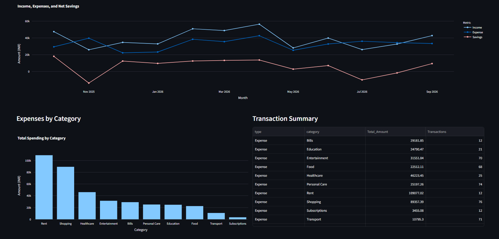
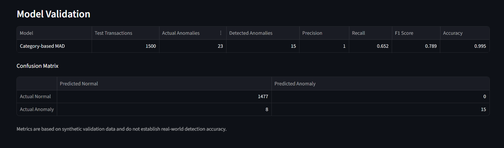

# Personal Finance Advisor with AI Analysis

An interactive personal finance analytics application built with Python, 
Pandas, Streamlit, and machine learning. The project analyzes financial 
transactions, visualizes spending patterns, calculates savings, and 
identifies potentially unusual expenses using statistical and machine 
learning techniques.

## Dashboard Preview



## Overview

Managing personal finances requires understanding income, expenses, 
savings, and spending behavior. This project demonstrates how data 
analytics and anomaly detection can help users explore their financial 
transactions and identify expenses that may deserve further investigation.

The application uses a synthetic financial dataset to demonstrate 
financial analysis and anomaly detection through an interactive dashboard.

## Features

### 1. Financial Overview
- Total income and expenses.
- Net savings calculation.
- Savings rate calculation.
- Interactive date-range filtering.

### 2. Financial Data Analysis
- Monthly income and expense trends.
- Monthly net savings analysis.
- Category-wise expense summaries.
- Spending distribution visualization.
- Transaction summaries.

### 3. Anomaly Detection
The project implements two anomaly-detection approaches.

**Category-Based Median Absolute Deviation (MAD)**
- Identifies unusually high expenses relative to category spending.
- Calculates robust statistical deviation scores.
- Flags potentially unusual transactions.

**Isolation Forest**
- Uses an unsupervised machine learning algorithm.
- Identifies transactions that differ from typical spending patterns.
- Provides anomaly scores for investigation.

### 4. Model Evaluation
The project evaluates anomaly-detection performance using:
- Confusion matrix.
- Precision.
- Recall.
- F1-score.
- Accuracy.

It also includes a larger temporal validation experiment using 
separate reference and test periods.

### 5. Interactive Dashboard
The Streamlit dashboard provides:
- Financial summary cards.
- Monthly financial trend charts.
- Category spending charts.
- Spending distribution charts.
- Potential anomaly tables and visualizations.
- Model validation metrics.
- Transaction search and filtering.
- CSV download of filtered transactions.

## Technologies Used

| Technology | Purpose |
|---|---|
| Python | Application development and data analysis |
| Pandas | Data cleaning and manipulation |
| NumPy | Numerical operations and synthetic data generation |
| Matplotlib | Data visualization |
| Seaborn | Statistical visualization |
| Plotly | Interactive dashboard charts |
| Streamlit | Interactive web dashboard |
| Scikit-learn | Isolation Forest and model evaluation |
| Git | Version control |


## Screenshots

### Anomaly Detection


### Model Validation


## Anomaly Detection

The Personal Finance Advisor identifies potentially unusual expense transactions using statistical and machine-learning techniques.

### Detection Methods

- **Category-based Median Absolute Deviation (MAD):** Identifies unusual expenses relative to typical spending within a category.
- **Isolation Forest:** Detects transactions that differ from common spending patterns.

### Evaluation Metrics

Model performance can be assessed using:

- **Precision:** The proportion of flagged transactions that are actual anomalies.
- **Recall:** The proportion of actual anomalies successfully detected.
- **F1-score:** The harmonic mean of precision and recall.


## Project Structure

```text
personal-finance-advisor/
│
├── data-science/
│   ├── data/
│   │   ├── raw/
│   │   │   └── transactions.csv
│   │   │
│   │   └── processed/
│   │       ├── cleaned_transactions.csv
│   │       ├── monthly_summary.csv
│   │       ├── category_summary.csv
│   │       ├── anomaly_results.csv
│   │       ├── model_comparison.csv
│   │       ├── independent_model_validation.csv
│   │       ├── mad_temporal_validation.csv
│   │       └── mad_large_validation.csv
│   │
│   ├── models/
│   ├── notebooks/
│   │
│   ├── reports/
│   │   └── figures/
│   │       └── transaction_anomalies.png
│   │
│   └── src/
│       ├── generate_data.py
│       ├── analyze_data.py
│       ├── detect_anomalies.py
│       ├── evaluate_anomalies.py
│       ├── compare_anomaly_models.py
│       ├── validate_anomaly_models.py
│       ├── validate_mad_large.py
│       └── dashboard.py
│
├── .venv/
├── README.md
└── requirements.txt
